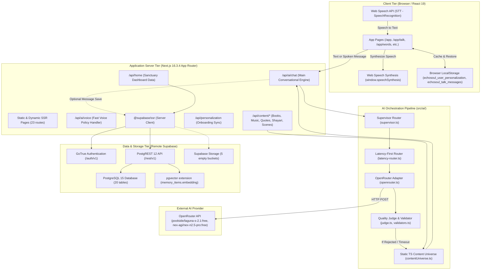

# EchoSoul Architecture Map & Data Flow Audit

**Date of Audit**: 2026-09-11  
**Audit Target**: EchoSoul System Architecture  
**Evaluator**: Antigravity Full Project Audit Engine  

---

## 1. System Topology Overview

EchoSoul is structured as a hybrid edge/server-rendered Next.js 16 application with an external OpenRouter LLM orchestration layer and a remote Supabase (PostgreSQL 15 + PostgREST + pgvector + GoTrue Auth) backend.

---

## 2. Component Interconnection & Health Matrix

| Connection Point | Source | Destination | Protocol / Method | Empirical Status | Latency / Health Finding |
| :--- | :--- | :--- | :--- | :--- | :--- |
| **Client UI $\to$ App Router** | Web Browser | Next.js Server | HTTP/1.1 (Port 3005) | `✅ VERIFIED WORKING` | 21ms – 46ms page latency across 21 pages. |
| **Client STT $\to$ Client State** | Web Speech API | `talk/page.tsx` | Browser Native Event | `🟡 PARTIALLY WORKING` | Chrome/Edge supported; Safari/Firefox fallback missing. Continuous listening active (9s silence limit). |
| **Client State $\to$ Client TTS** | `talk/page.tsx` | `speechSynthesis` | Browser Native API | `🟡 PARTIALLY WORKING` | Complete text synthesized after full LLM response; no sentence chunk streaming. |
| **Client $\to$ /api/ai/chat** | `talk/page.tsx` | `/api/ai/chat` | HTTP POST (JSON) | `✅ VERIFIED WORKING` | HTTP 200 returned consistently (327ms – 618ms). |
| **/api/ai/chat $\to$ Supervisor** | `/api/ai/chat` | `supervisor.ts` | In-process function | `✅ VERIFIED WORKING` | Rule-based signals detect literature, music, moments, and listening needs. |
| **/api/ai/chat $\to$ OpenRouter** | `openrouter.ts` | `openrouter.ai/api/v1` | HTTPS POST | `🟡 PARTIALLY WORKING` | Free-tier models frequently rate-limit or fail schema validation; adapter triggers `SAFE_FALLBACK_RESPONSE`. |
| **/api/ai/chat $\to$ Quality Judge** | `judge.ts` | `/api/ai/chat` | In-process function | `✅ VERIFIED WORKING` | Evaluates tone, hallmarked quotes, and brevity. Rejects invalid outputs and triggers curated fallback. |
| **/api/ai/chat $\to$ Supabase DB** | `/api/ai/chat` | `messages` table | PostgREST INSERT | `🔴 BROKEN` | Anonymous users bypass DB save; authenticated sessions fail if session cookie missing. 0 rows saved. |
| **Client $\to$ /api/content/*** | Client Pages | Content Endpoints | HTTP GET | `✅ VERIFIED WORKING` | 17ms – 50ms responses serving curated static JSON from TypeScript modules. |
| **Content Endpoints $\to$ Remote DB** | Content Endpoints | `literature_works` | PostgREST SELECT | `⚪ NOT IMPLEMENTED` | All content routes bypass Supabase entirely, querying static memory files (`contentUniverse.ts`). |
| **Home Screen $\to$ /api/home** | `/app` | `/api/home` | HTTP GET | `🟡 PARTIALLY WORKING` | Returns 401 when unauthenticated (expected auth barrier); falls back to client `localStorage`. |
| **Storage Subsystem** | UI Media | Supabase Storage | S3 / HTTP API | `🔴 BROKEN` | 5 buckets exist but are completely empty (0 files). All UI media served from local `public/` directory. |
| **pgvector Embeddings** | Backend | `memory_items` | pgvector | `⚫ BLOCKED` | Schema contains `vector(1536)` column, but `OPENROUTER_EMBEDDING_MODEL` is unconfigured. 0 vectors stored. |

---

## 3. End-to-End Execution Trace

### 3.1 Trace A: Voice Interaction Flow (`/app/talk`)
1. **User Speaks**: Browser Web Speech API (`webkitSpeechRecognition`) captures microphone input.
2. **Silence Detection**: A 9-second silence debounce timer monitors transcript accumulation.
3. **Transmission**: `handleSend()` posts `{ message, personalization, is_voice: true }` to `/api/ai/chat`.
4. **Policy Enforcement**: `chat/route.ts` selects `ROUTING_POLICIES.FAST_VOICE` (target $<400$ms, model: `poolside/laguna-s-2.1:free`).
5. **Supervisor Routing**: `supervisorDecide` identifies intent; sets `presentation_mode: "conversational"` and concise spoken sentence length.
6. **LLM Generation / Fallback**: If OpenRouter succeeds, raw text is sanitized by `sanitizeAiText()`. If OpenRouter fails or returns empty/non-JSON, `generateCuratedContextualResponse()` or `SAFE_FALLBACK_RESPONSE` is served.
7. **Client Reception & Playback**: Frontend receives canonical JSON, initiates typewriter text render, and invokes `window.speechSynthesis.speak()` on the complete text string.

### 3.2 Trace B: Content Discovery Flow (`/app/words` & `/app/music`)
1. **Page Mount**: Client requests `/api/content/literature/search` or `/api/content/music/recommended`.
2. **Static Resolver**: Server queries local compiled TypeScript arrays (`CONTENT_UNIVERSE`, `RECOMMENDED_BOOKS`, `HINDI_SOUL_CATALOG`).
3. **Response**: Rich metadata (author, year, excerpt, audio preview URL, cover art) returns in $<50$ms.
4. **Remote DB Disconnect**: Remote Supabase tables (`literature_works`, `literary_passages`, `music_tracks`, `master_music_catalog`) remain at 0 rows.

---

## 4. Architectural Debt & Critical Gaps
1. **Split-Brain Content**: High-quality content exists in memory (`src/lib/content/`) but is completely missing from Supabase. Any attempt to query PostgREST directly returns empty arrays.
2. **Missing Database Persistence**: The user profile and session tables in Supabase contain 1 profile and 0 messages. The application runs almost exclusively as a stateful client SPA backed by `localStorage`.
3. **Voice Latency Bottleneck (Architecture A vs B)**: Voice mode waits for the complete LLM response before triggering Web Speech Synthesis. To achieve human-like interactive cadence ($<800$ms total audio-to-audio turnaround), sentence-chunked streaming TTS (Architecture B) is required.
