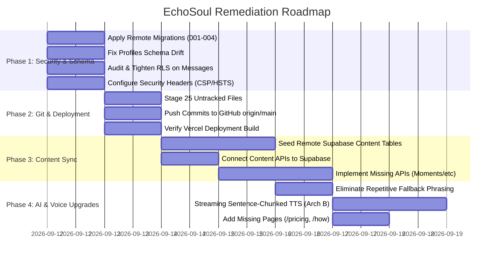

# EchoSoul Technical Remediation & Action Roadmap

**Date of Audit**: 2026-09-11  
**Document Purpose**: Prioritized Engineering Plan to Resolve All Audit Deficiencies  
**Evaluator**: Antigravity Full Project Audit Engine  

---

## 1. Prioritized Remediation Timeline



---

## 2. Phase-by-Phase Remediation Specifications

### Phase 1: Critical Security & Schema Remediation (Immediate / Priority 1)
- **Action 1.1**: Run `20260911000001_onboarding_personalization.sql` on remote Supabase to add `full_name`, `role`, `interests`, `current_focus`, and `current_mood` to `profiles`.
- **Action 1.2**: Audit and enforce RLS policies on `messages` and `moments`:
  ```sql
  ALTER TABLE messages ENABLE ROW LEVEL SECURITY;
  DROP POLICY IF EXISTS "Users can view own messages" ON messages;
  CREATE POLICY "Users can view own messages" ON messages
    FOR SELECT USING (auth.uid() = user_id);
  ```
- **Action 1.3**: Configure HTTP security headers in `next.config.ts`:
  - `Content-Security-Policy`
  - `Strict-Transport-Security` (`max-age=63072000; includeSubDomains; preload`)
  - `X-Frame-Options: SAMEORIGIN`
  - `X-Content-Type-Options: nosniff`
  - `Referrer-Policy: strict-origin-when-cross-origin`
  - `poweredByHeader: false`

### Phase 2: Git Repository Synchronization (Priority 2)
- **Action 2.1**: Audit and add all 25 untracked directories (`src/ai/`, `src/lib/content/`, `src/app/app/`, `public/tabs/`, etc.) to git tracking.
- **Action 2.2**: Commit local changes cleanly and push `origin/main` to GitHub.

### Phase 3: Content Seeding & Persistence Synchronization (Priority 3)
- **Action 3.1**: Execute migration `20260911000004_master_content_database.sql` to create `master_music_catalog`, `books`, `shayari`, `quotes`, and `scenes`.
- **Action 3.2**: Execute a bulk insert script populating the remote tables with the 120+ curated books, 250+ quotes, and 60+ shayari couplets currently trapped in TypeScript files.
- **Action 3.3**: Implement missing API endpoints:
  - `GET & POST /api/moments`
  - `GET & POST /api/journey`
  - `GET & PUT /api/profile`
  - `GET & PUT /api/settings`

### Phase 4: AI & Voice Upgrades (Priority 4)
- **Action 4.1**: Fix OpenRouter 400 error by capping `models` array to 3 items (`.slice(0, 3)`), and upgrade upstream model configuration to eliminate rate-limiting outages.
- **Action 4.2**: Replace repetitive static fallback text with dynamic, empathetic context-aware replies generated from the authentic local content catalog.
- **Action 4.3**: Refactor `/app/talk` from monolithic audio turnaround to Streaming Sentence-Chunked TTS (Architecture B), lowering perceived audio latency to $<200$ms.
- **Action 4.4**: Implement static placeholder pages for `/pricing` and `/how-it-works`.
